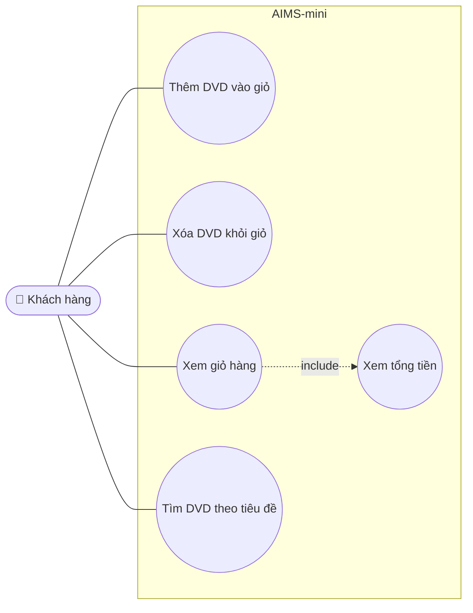

# AIMS-mini - Biểu đồ Use Case

| Use case | Mô tả | Hiện thực |
|---|---|---|
| Thêm DVD vào giỏ | Thêm một đĩa; giỏ chứa tối đa `MAX_NUMBERS_ORDERED` = 20 đĩa | `Cart.add_dvd()` |
| Xóa DVD khỏi giỏ | Xóa một đĩa đang có trong giỏ | `Cart.remove_dvd()` |
| Xem giỏ hàng | In danh sách đĩa và tổng tiền; giỏ trống thì in "The cart is empty" | `Cart.print_cart()` |
| Tìm DVD theo tiêu đề | Trả về các đĩa có tiêu đề chứa từ khóa | `aims.search.search_by_title()` |
| Xem tổng tiền | Tổng giá các đĩa trong giỏ | `Cart.total_cost()` |
